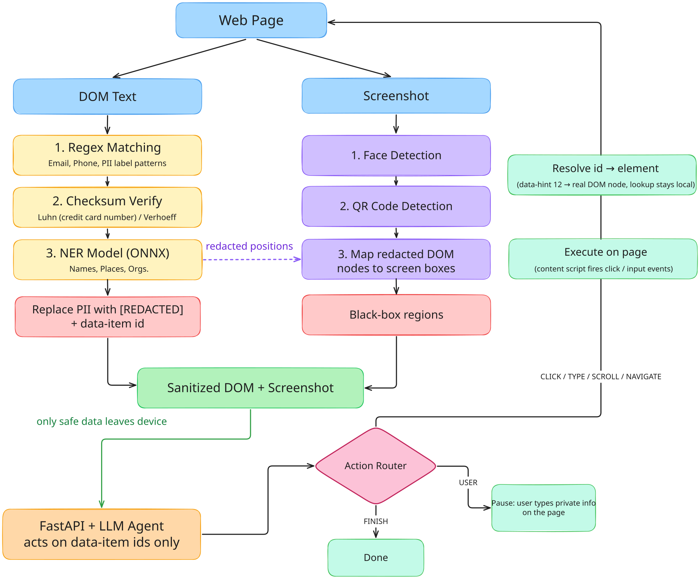

# 🛡️ PrivSight — Privacy-Preserving Browser Agent

## Table of Contents

1. [What is PrivSight?](#1-what-is-privsight)
2. [The Problem We Are Solving](#2-the-problem-we-are-solving)
3. [How PrivSight Solves It](#3-how-privsight-solves-it)
11. [How to Load and Test the Extension](#4-how-to-load-and-test-the-extension)

---

## 1. What is PrivSight?

PrivSight is a **Google Chrome browser extension** that acts as a privacy-first AI assistant.

Think of it like this — imagine you hired a personal assistant to help you browse the web. You want them to:
- Fill out forms for you
- Summarize articles
- Find information on a page

But you do NOT want them to write down your credit card number, your email, your passwords, or your personal details and hand that over to someone else.

**That is exactly what PrivSight does.** It acts as a smart, privacy-respecting middleman between your browser and any AI model.

---

## 2. The Problem We Are Solving

Modern AI tools (like ChatGPT, Gemini, etc.) are being connected to browsers so they can "browse the web" on your behalf. The way most of them work today is:

```
Your Webpage (with ALL your private data)
         ↓
Sent directly to the AI server in the cloud
         ↓
AI reads everything — your emails, passwords, names, credit cards
```

This is a **massive privacy risk**. The AI sees everything on the page — not just what you want it to see.

---

## 3. How PrivSight Solves It

PrivSight sits in the middle and acts as a **filter**:

```
Your Webpage (with ALL your private data)
         ↓
PrivSight scans the page locally, inside your browser
         ↓
Sensitive items are detected (emails, names, passwords, card numbers)
         ↓
Sensitive items are masked/removed → replaced with safe placeholders
         ↓
Only the clean, safe version goes to the AI
         ↓
AI answers your question without ever seeing your private data
```


### The Privacy Pipeline

| Step | What it means |
|------|--------------|
| **Data Found** | Total number of text items/elements found on the page |
| **Sensitive Recognized** | Items that were identified as personal or sensitive |
| **Sensitive Removed** | Items that were successfully masked before reaching AI |

If Sensitive Removed = Sensitive Recognized → **100% protection achieved.**

---

### 📄 `manifest.json` — The Extension's Identity Card

This is the very first file Chrome reads. It tells Chrome:

- What is this extension called?
- What version is it?
- What files should it use?
- What permissions does it need?

```json
{
  "manifest_version": 3,
  "name": "PrivSight",
  "version": "1.0.0",
  "description": "Privacy-preserving browser agent.",
  "permissions": ["activeTab", "scripting"],
  "action": {
    "default_popup": "popup/popup.html"
  },
  "background": {
    "service_worker": "background/service-worker.js"
  },
  "content_scripts": [
    {
      "matches": ["<all_urls>"],
      "js": ["content/agent.js"]
    }
  ]
}
```

**What each part means:**

| Key | What it does |
|-----|-------------|
| `manifest_version: 3` | We are using the latest Chrome extension standard (V3) |
| `permissions: ["activeTab", "scripting"]` | We need to see the active tab and inject scripts into it |
| `action.default_popup` | When the user clicks the icon, open `popup.html` |
| `background.service_worker` | Run `service-worker.js` silently in the background |
| `content_scripts` | Automatically inject `agent.js` into all webpages the user opens after the extension loads |

**Why Manifest V3 (not V2)?**
V3 is Google's modern, secure standard. It replaced the old V2. The biggest change is that background scripts are now "Service Workers" — they are lightweight, start only when needed, and stop when idle. This is better for performance and security.

---
## 4. How to Load and Test the Extension

### Loading it into Chrome

1. Open Chrome and go to: `chrome://extensions`
2. Turn on **Developer mode** (toggle in the top-right corner)
3. Click **Load unpacked**
4. Select the folder: `d:\SIH26\Frontend\PrivSight`
5. PrivSight will appear in your extensions list
6. Click the puzzle piece icon in the Chrome toolbar → Pin PrivSight

### Using it

1. Open any webpage (e.g. `https://example.com` or `https://github.com`)
2. Click the **PrivSight shield icon** in the toolbar
3. Type a prompt (e.g. "Summarize this page")
4. Click the → arrow or press Enter

### What you will see

| Location | What Happens |
|----------|-------------|
| **The webpage** | Subtle dark veil appears, page becomes non-clickable, thin electric-blue Aurora flows around all 4 viewport edges, PrivSight shield logo pulses in the center |
| **The popup** | Status steps through: Connecting → Reading → Protecting → Understanding → Planning → Executing |
| **Privacy stats** | The 3 numbers count up live as the agent progresses |
| **After ~7 seconds** | Aurora fades out, page returns to normal, popup shows the agent's reply, stats show 100% protected |

### Reloading after code changes

Every time you edit a file, go to `chrome://extensions` → find PrivSight → click the **↻ reload** button. Then test again on an open tab.

### Inspecting the overlay with DevTools

While the Aurora is visible on the webpage:
1. Press **F12** to open DevTools
2. Go to the **Elements** tab
3. Scroll to the bottom of `<html>` → find `<div id="privsight-overlay">`
4. Expand it → you will see the `#shadow-root` containing all the Aurora elements
5. Go to the **Console** tab → you will see:
   ```
   [PrivSight] Overlay active — page locked while agent works.
   [PrivSight] Overlay removed — page restored.
   ```

---

*Built with Vanilla HTML, CSS, and JavaScript. No frameworks. No build tools. Just the browser.*
